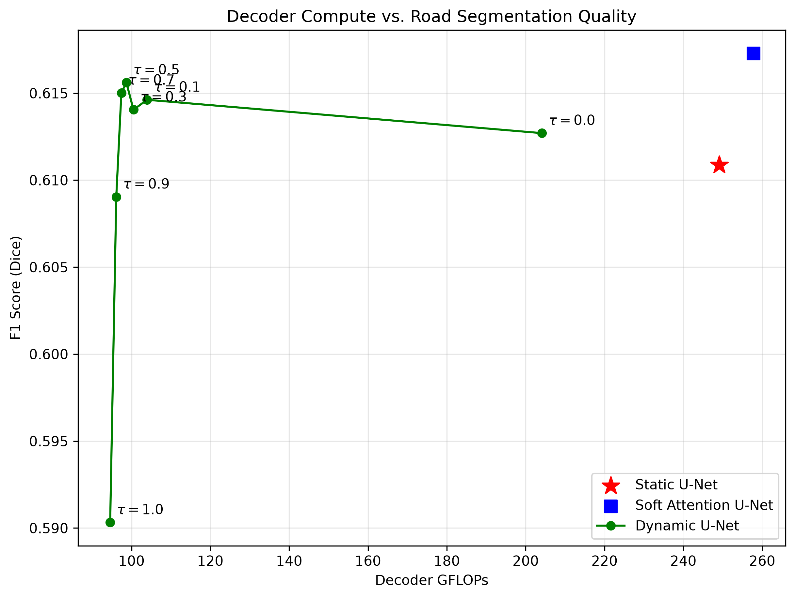
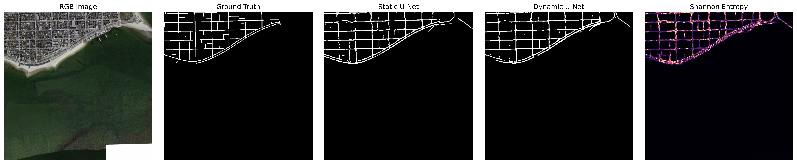
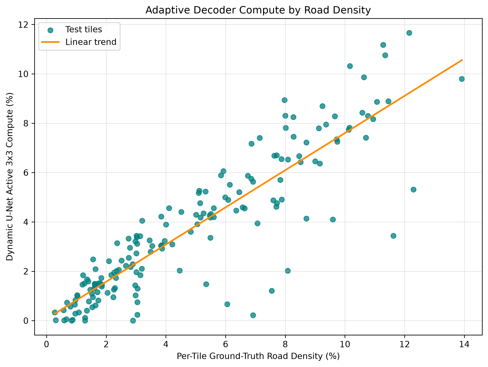
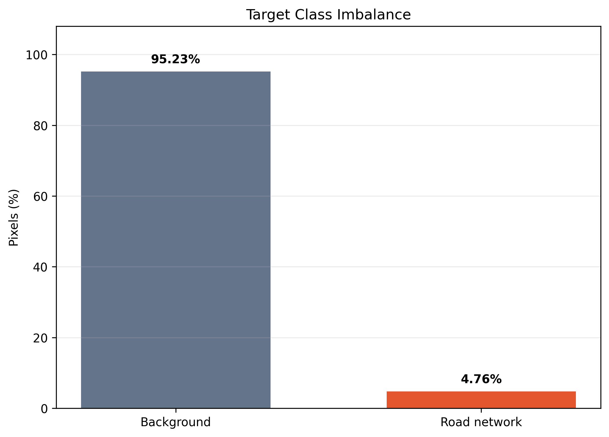
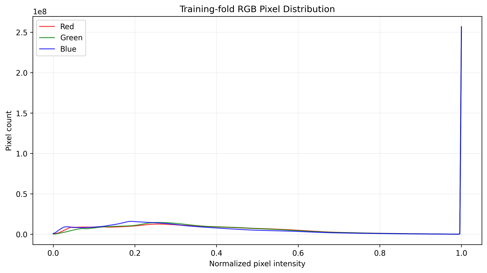
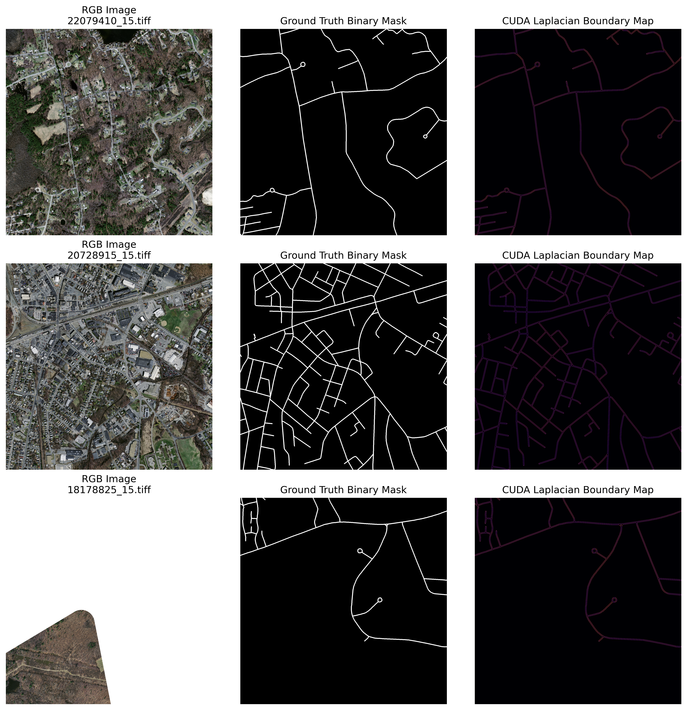

# Dynamic Spatial Routing for Compute-Efficient Satellite Road Extraction

**Author:** Anjney Lawaniya (Roll No. 2402CS11)  
**Institution:** Indian Institute of Technology Patna (CS3103 Machine Learning Project)  
**Research Group:** IMPACT (Imaging, Modelling, Perception, Analytics & Computational Technologies)

<p align="center">
  <strong>Decoder Compute vs. F1 Pareto Frontier</strong><br />
  <br /><br />
  <strong>Segmentation Prediction and Entropy Overlay</strong><br />
  <br /><br />
  <strong>Adaptive Decoder Compute by Road Density</strong><br />
  <br /><br />
  <strong>Training Target Class Imbalance</strong><br />
  <br /><br />
  <strong>Training RGB Intensity Distribution</strong><br />
  <br /><br />
  <strong>Training Images, Masks, and Boundary Maps</strong><br />
  
</p>

##  Project Overview

Automated extraction of road networks from high-resolution satellite imagery is computationally expensive because standard convolutional architectures (like U-Net) apply dense $3 \times 3$ convolutions uniformly across the entire image. On the **Massachusetts Roads Dataset**, road networks occupy only $4.76\%$ of the spatial domain, meaning standard decoders waste over 64% of total network FLOPs on empty background terrain.

This repository implements a **Dynamic U-Net** governed by **Parameter-Free Shannon Entropy Gating** and a **Dual-Path Sparse-Dense Decoder**. 

### Key Features
*   **Zero-Parameter Gating:** Computes normalized binary Shannon entropy $H(p) \in [0, 1]$ directly from deep-supervised auxiliary logits.
*   **Straight-Through Estimator (STE):** Binarizes the entropy mask for discrete routing while preserving end-to-end differentiability.
*   **Dual-Path Decoder:** Routes uncertain road boundaries to sparse $3 \times 3$ convolutions and bypasses high-confidence backgrounds via lightweight $1 \times 1$ projections.
*   **Halo-Aware FLOPs Profiler:** Analytically accounts for the $3 \times 3$ receptive-field dilation halo required when stacking sparse convolutional layers.

##  Key Results

Evaluated on the held-out test split ($N = 167$ tiles, $43.78$M pixels) at the validation-optimal threshold $\tau = 0.5$:
*   **60.39% Decoder Compute Reduction:** Cuts decoder compute from 249.14 GFLOPs (Static U-Net) to 98.69 nominal / 104.81 halo-adjusted GFLOPs.
*   **Superior Accuracy:** Improves Test Micro-F1 from 0.61088 (Static U-Net) to **0.61561**.
*   **Budget-Matched Proof:** Mathematically proves Shannon Entropy routing outperforms Random Bernoulli (+2.30 F1) and Inverted Confidence (+2.73 F1) routing under identical active pixel budgets.

##  Repository Structure

```text
├── data/
│   ├── raw/                  # Raw TIFF images and labels (Massachusetts Roads)
│   └── splits/               # Deterministic 70/15/15 train/val/test manifests
├── src/
│   ├── dataset.py            # Dataset loading and split generation (Seed 67)
│   ├── dataloaders.py        # PyTorch DataLoaders and strict interpolation modes
│   ├── transforms.py         # Geometric augmentations and Z-score normalization
│   ├── eda.py / audit.py     # Training-fold integrity audit and class balance
│   ├── entropy_gate.py       # Parameter-free ShannonEntropyGate with STE
│   ├── dynamic_unet.py       # GatedDecoderStage and DualPathDecoderBlock
│   ├── baselines.py          # Static U-Net and Soft Attention U-Net
│   ├── losses.py             # DynamicUNetLoss (BCE + Dice + DeepSup + L1 Sparsity)
│   ├── metrics.py            # Micro-F1, IoU, Boundary F1, and HD95
│   └── train.py              # AMP mixed-precision training CLI
├── evaluation.ipynb          # End-to-end notebook reproducing all tables/figures
└── README.md
```

##  Installation & Setup

1. **Clone the repository:**
   ```bash
   git clone https://github.com/Anjney-Lawaniya/ML_Project_CS3103_image_segmentation
   cd dynamic-unet-road-extraction
   ```

2. **Install dependencies:**
   ```bash
   pip install -r requirements.txt
   ```
   *(Requires PyTorch $\ge$ 2.0 with CUDA support, Torchvision, Numpy, OpenCV, Matplotlib, Scikit-learn)*

3. **Download the Dataset:**
   Download the [Massachusetts Roads Dataset](https://www.cs.toronto.edu/~vmnih/data/) and place the train/val/test `.tiff` files in `data/raw/tiff/`.

## Usage

**To train the Dynamic U-Net:**
```bash
python src/train.py --model dynamic --batch_size 4 --accumulate_steps 4 --epochs 20
```

**To evaluate and generate plots:**
Open and run `evaluation.ipynb` in Jupyter Notebook or VS Code to reproduce the Pareto frontier, adaptive compute scatter, and qualitative overlay maps.

##  License & Citation
This project was completed as part of the CS3103 Machine Learning curriculum at IIT Patna. If you use this code in your research, please link back to this repository.

**Anjney Lawaniya**<br>
**2402CS11**<br>
[anjney_2402cs11@iitp.ac.in](mailto:anjney_2402cs11@iitp.ac.in)
